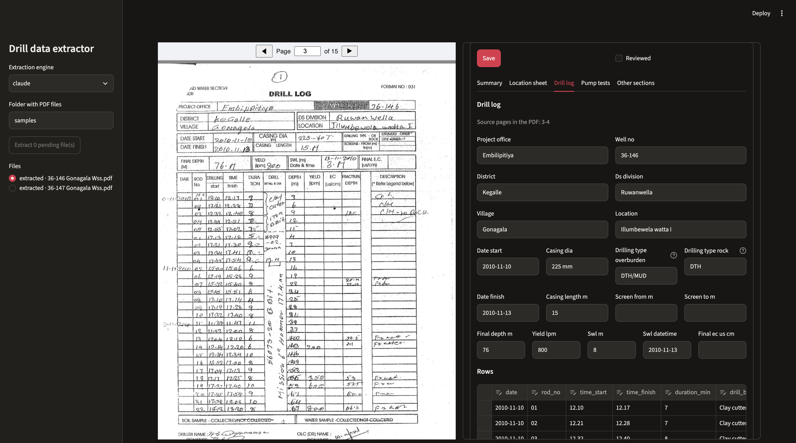

# Drill data extractor

Extracts data from scanned well drilling files (PDF) and lets you check and correct it side by side with the scan. The corrected data is saved to a SQLite database for later use, such as machine learning model training.



Each file is expected to contain a Site Location Sheet, a Drill Log, pumping test reports and supporting letters. The forms are handwritten scans, so extraction uses a vision model (Claude or Gemini) and the result is meant to be reviewed.

## Installation

The app runs on Windows, macOS and Linux. You need [Git](https://git-scm.com/downloads) and [uv](https://docs.astral.sh/uv/getting-started/installation/); uv installs Python and the dependencies for you.

### Windows (PowerShell)

Install uv, then close and reopen PowerShell so the `uv` command is found:

```powershell
powershell -ExecutionPolicy ByPass -c "irm https://astral.sh/uv/install.ps1 | iex"
```

Get the app and install its dependencies:

```powershell
git clone https://github.com/chammika/drill-data-extactor.git
cd drill-data-extactor
uv sync
```

### macOS and Linux

Install uv, then open a new terminal so the `uv` command is found:

```bash
curl -LsSf https://astral.sh/uv/install.sh | sh
```

Get the app and install its dependencies:

```bash
git clone https://github.com/chammika/drill-data-extactor.git
cd drill-data-extactor
uv sync
```

If you don't have Git, download the repository as a ZIP from GitHub (**Code > Download ZIP**), unzip it, and run `uv sync` inside the folder.

## Running

Set an API key for the extraction engine you want to use, then start the app from the project folder. The key only applies to the terminal window you set it in.

### Windows (PowerShell)

```powershell
$env:ANTHROPIC_API_KEY = "..."   # Claude (default)
$env:GEMINI_API_KEY = "..."      # Gemini
uv run streamlit run app.py
```

To start with Gemini selected, run `$env:EXTRACTOR = "gemini"` first. The Gemini model can be changed with `$env:GEMINI_MODEL = "<model id>"`.

### macOS and Linux

```bash
export ANTHROPIC_API_KEY=...   # Claude (default)
export GEMINI_API_KEY=...      # Gemini
uv run streamlit run app.py
```

To start with Gemini selected, run `export EXTRACTOR=gemini` first. The Gemini model can be changed with `export GEMINI_MODEL=<model id>`.

On every system the app opens in your browser at http://localhost:8501. Press Ctrl+C in the terminal to stop it.

## Usage

1. Put your PDF files in a folder (`samples/` by default) and enter its path in the sidebar.
2. Choose the extraction engine, then extract one file or all pending files.
3. Select a file. The scan is on the left with page navigation; the extracted data is on the right in tabs: Summary, Location sheet, Drill log, Pump tests and Other sections.
4. Correct any values, tick **Reviewed** when the record is checked, and press **Save**.

A file that has already been extracted is not extracted again, and a file whose Well No is already in the database loads the existing record.

## Data

Everything is stored in `drill_data.db` (SQLite) in the project folder:

| Table | Contents |
|---|---|
| `wells` | One row per well: summary fields, reviewed flag, the edited data and the original extraction as JSON |
| `drill_log_rows` | One row per drill log line |
| `pump_tests` | One row per pumping test |
| `other_sections` | Letters, job cards and other free text |
| `files` | Which PDF belongs to which well |

All values are stored as text, as written on the forms.
